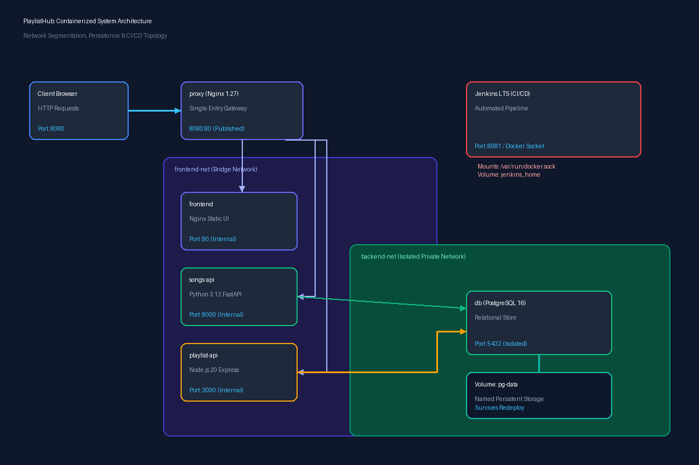

# PlaylistHub: Containerized Music Infrastructure & Automated CI/CD

> **System Architecture and Integration — Final Project**  
> Enterprise-grade microservice orchestration and automated DevOps pipeline powered by **Docker**, **Docker Compose**, **Nginx**, and **Jenkinss**.

---

## Table of Contents
1. [Project Overview](#1-project-overview)
2. [System Architecture & Network Topology](#2-system-architecture--network-topology)
3. [Component Deep-Dive & Container Matrix](#3-component-deep-dive--container-matrix)
4. [Network Segmentation & Security Model](#4-network-segmentation--security-model)
5. [Reverse Proxy Ingress & Route Dispatching](#5-reverse-proxy-ingress--route-dispatching)
6. [Data Layer & Named Volume Persistence](#6-data-layer--named-volume-persistence)
7. [CI/CD Pipeline Architecture & Quality Gates](#7-cicd-pipeline-architecture--quality-gates)
8. [End-to-End Request Lifecycle](#8-end-to-end-request-lifecycle)
9. [Team Composition & Deliverable Ownership](#9-team-composition--deliverable-ownership)
10. [Quickstart: Local Application Stack](#10-quickstart-local-application-stack)
11. [Jenkins CI/CD Automation Setup](#11-jenkins-cicd-automation-setup)
12. [Live Demonstration Guide](#12-live-demonstration-guide)

---

## 1. Project Overview

**PlaylistHub** is an automated, polyglot microservice music management system engineered to fulfill and exceed the requirements of enterprise-grade Systems Integration and DevOps standards:

* **Decoupled Polyglot Architecture:** Disparate technology stacks—**Python 3.12 FastAPI** (`songs-api`) and **Node.js 20 Express** (`playlist-api`)—collaborate seamlessly over internal Docker networks and persist relational data into an isolated **PostgreSQL 16** container.
* **Single Public Ingress Point:** An **Nginx 1.27 reverse proxy** on port `8080` mediates all inbound client traffic, shielding internal application components and preventing direct host exposure to the database.
* **Declarative Quality Gates:** Every code change pushed to GitHub triggers an automated Jenkins pipeline that validates unit tests concurrently inside multi-stage Docker builds. Failing tests immediately abort deployment, preventing broken code from reaching production.
* **Zero-Downtime Deployment & Instant Rollback:** Verified builds are tagged with sequential Jenkins build numbers (`__BUILD_NUMBER__`), deployed via `docker compose`, and guarded by a 1-click parameterized rollback pipeline (`Jenkinsfile.rollback`).

---

## 2. System Architecture & Network Topology



### High-Level Topology Diagram

```
[ Client Web Browser ]
         │
         │  HTTP / Port 8080 (Public Ingress)
         ▼
┌────────────────────────────────────────────────────────────────────────┐
│  REVERSE PROXY GATEWAY: proxy (Nginx 1.27 Alpine)                      │
│  - Routes /               ──► frontend     (port 80)                   │
│  - Routes /api/songs/     ──► songs-api    (port 8000)                 │
│  - Routes /api/playlists/ ──► playlist-api (port 3000)                 │
│  - Probes /nginx-health   ──► Static HTTP 200 Probe                    │
└──────────────┬──────────────────────────────────────────┬──────────────┘
               │                                          │
       [ frontend-net ]                           [ frontend-net ]
               │                                          │
       ┌───────▼────────┐                         ┌───────▼────────┐
       │    frontend    │                         │   songs-api    │ (Python 3.12 FastAPI)
       │ (Nginx Static) │                         │  - Port 8000   │
       └────────────────┘                         └───────┬────────┘
                                                          │
                                                  [ backend-net ]
                                                          │
       ┌────────────────┐                         ┌───────▼────────┐
       │  playlist-api  ├─────────────────────────►       db       │ (PostgreSQL 16)
       │ (Node Express) │      [ backend-net ]    │  - Port 5432   │ (NO HOST PORT)
       │  - Port 3000   │                         └───────┬────────┘
       └───────▲────────┘                                 │
               │                                   [ Named Volume ]
       [ frontend-net ]                                   │
                                                  ┌───────▼────────┐
                                                  │    pg-data     │ (Persistent Storage)
                                                  └────────────────┘

────────────────────────────────────────────────────────────────────────────
ISOLATED CI/CD INFRASTRUCTURE (Separately Deployed)
┌────────────────────────────────────────────────────────────────────────┐
│  infra/jenkins (Jenkins LTS :8081)                                     │
│  - Mounts /var/run/docker.sock (Docker-out-of-Docker Engine)           │
│  - Injects playlisthub-env credentials                                 │
│  - Executes Quality Gates, Tags Images, Runs Smoke Tests               │
└────────────────────────────────────────────────────────────────────────┘
```

---

## 3. Component Deep-Dive & Container Matrix

| Container Name | Service Role | Technology Stack | Base Image | Published Host Port | Internal Networks | Persistent Storage |
| :--- | :--- | :--- | :--- | :--- | :--- | :--- |
| **`proxy`** | API Gateway & Ingress | Nginx 1.27 | `nginx:1.27-alpine` | `8080:8080` | `frontend-net` | None (Stateless) |
| **`frontend`** | Web Dashboard UI | Nginx + HTML5 / CSS3 / JS | `nginx:1.27-alpine` | *None (Internal 80)* | `frontend-net` | None (Build injection) |
| **`songs-api`** | Music Catalog Microservice | Python 3.12 + FastAPI + Uvicorn | `python:3.12-slim` | *None (Internal 8000)* | `frontend-net`, `backend-net` | None (Stateless API) |
| **`playlist-api`** | Playlist Curation Microservice | Node.js 20 + Express + pg | `node:20-alpine` | *None (Internal 3000)* | `frontend-net`, `backend-net` | None (Stateless API) |
| **`db`** | Relational Database | PostgreSQL 16 | `postgres:16-alpine` | *None (Internal 5432)* | `backend-net` | Named volume `pg-data` |
| **`jenkins`** | Standalone CI/CD Automation | Jenkins LTS + Docker CLI | `jenkins/jenkins:lts` | `8081:8080` | Host Bridge (`infra/jenkins`) | Named volume `jenkins-data` |

---

## 4. Network Segmentation & Security Model

To uphold enterprise security standards and the **Principle of Least Privilege**, the application topology is segmented into two isolated bridge networks:

### 1. `frontend-net` (DMZ / Client Access Tier)
* **Connected Services:** `proxy`, `frontend`, `songs-api`, `playlist-api`.
* **Purpose:** Allows the reverse proxy to dispatch client requests to the UI and microservices.
* **Security Restriction:** The `db` container is **not attached** to this network. If a public client attempts to reach the database, the proxy has no routing path, and the network bridge cannot resolve the `db` hostname.

### 2. `backend-net` (Secure Data Tier)
* **Connected Services:** `songs-api`, `playlist-api`, `db`.
* **Purpose:** Allows the two backend microservices to execute SQL queries and maintain connection pools against PostgreSQL.
* **Security Restriction:** The `proxy` and `frontend` containers are **not attached** to this network. 
* **Zero Host Port Exposure:** PostgreSQL listens exclusively on internal port `5432`. No port mapping (`5432:5432`) exists on the host machine, eliminating exposure to network port scanners.

---

## 5. Reverse Proxy Ingress & Route Dispatching

The Nginx reverse proxy serves as the sole public gateway on host port `8080`. All routing is configured in [`proxy/nginx.conf`](proxy/nginx.conf):

```nginx
upstream frontend_svc    { server frontend:80; }
upstream songs_api_svc   { server songs-api:8000; }
upstream playlist_api_svc{ server playlist-api:3000; }
```

### Route Dispatching Matrix

| Request URI Pattern | Target Upstream | Target Container Port | Description & Handling |
| :--- | :--- | :--- | :--- |
| **`/`** | `frontend_svc` | `frontend:80` | Serves the web dashboard, static HTML, CSS stylesheets, and client JavaScript. |
| **`/api/songs/`** | `songs_api_svc` | `songs-api:8000/` | Proxies song catalog requests; strips `/api/songs/` prefix before forwarding to FastAPI. |
| **`/api/playlists/`** | `playlist_api_svc` | `playlist-api:3000/` | Proxies playlist operations; strips `/api/playlists/` prefix before forwarding to Express. |
| **`/nginx-health`** | Internal Nginx | Port `8080` | Responds immediately with HTTP 200 `healthy\n` without hitting downstream containers. |

### Upstream Header Forwarding
The proxy passes essential client metadata so downstream microservices can accurately trace sessions:
```nginx
proxy_set_header Host $host;
proxy_set_header X-Real-IP $remote_addr;
proxy_set_header X-Forwarded-For $proxy_add_x_forwarded_for;
proxy_set_header X-Forwarded-Proto $scheme;
```

---

## 6. Data Layer & Named Volume Persistence

The database layer runs on **PostgreSQL 16 Alpine**. Schema creation and initial seeding are executed automatically on initial container bootstrap via [`db/init.sql`](db/init.sql):

### Relational Schema Design
```
┌──────────────────┐       ┌──────────────────────┐       ┌──────────────────┐
│      songs       │       │    playlist_songs    │       │    playlists     │
├──────────────────┤       ├──────────────────────┤       ├──────────────────┤
│ id (PK)          │◄──────┤ song_id (FK, Cascade)│      ┌┤ id (PK)          │
│ title            │       │ playlist_id (FK)     ├──────┘│ name             │
│ artist           │       │ position             │       │ created_at       │
│ genre            │       │ added_at             │       └──────────────────┘
│ duration_seconds │       └──────────────────────┘
│ created_at       │         UNIQUE(playlist_id,
└──────────────────┘                song_id)
```

* **Foreign Key Constraints & Cascading:** Deleting a playlist automatically purges its associated records in `playlist_songs` without leaving orphaned rows.
* **Duplicate Prevention:** Unique constraint `UNIQUE(playlist_id, song_id)` prevents the same track from appearing multiple times in the same playlist, enforced in `playlist-api` with HTTP `409 Conflict`.
* **Named Volume Persistence:** The PostgreSQL storage path `/var/lib/postgresql/data` is mounted to the named volume **`pg-data`**. Executing `docker compose down` deletes the container instances but leaves `pg-data` untouched, ensuring zero data loss across deployments.

---

## 7. CI/CD Pipeline Architecture & Quality Gates

The deployment pipeline is declared entirely as code in [`Jenkinsfile`](Jenkinsfile) using **Declarative Pipeline syntax**:

```
[ Developer Push ] ──► [ GitHub Webhook / Polling ]
                              │
                              ▼
┌────────────────────────────────────────────────────────────────────────┐
│  STAGE 1: CHECKOUT (Clones git commit from GitHub)                     │
└─────────────────────────────┬──────────────────────────────────────────┘
                              │
                              ▼
┌────────────────────────────────────────────────────────────────────────┐
│  STAGE 2: QUALITY GATE (Parallel Automated Testing)                    │
│  ┌──────────────────────────────────┬────────────────────────────────┐ │
│  │ Test songs-api (PyTest)          │ Test playlist-api (Jest)       │ │
│  │ `docker build --target test ...` │ `docker build --target test ...│ │
│  └──────────────────────────────────┴────────────────────────────────┘ │
│  * ANY FAILURE IN EITHER TEST SUITE IMMEDIATELY TERMINATES THE BUILD!  │
└─────────────────────────────┬──────────────────────────────────────────┘
                              │ (All Tests Pass)
                              ▼
┌────────────────────────────────────────────────────────────────────────┐
│  STAGE 3: BUILD IMAGES (Tags images with BUILD_NUMBER)                 │
│  - Bakes Build Release Badge into frontend HTML                        │
│  - Tags: playlisthub-frontend:${BUILD_NUMBER}, etc.                    │
└─────────────────────────────┬──────────────────────────────────────────┘
                              │
                              ▼
┌────────────────────────────────────────────────────────────────────────┐
│  STAGE 4: DEPLOY (Zero-Downtime Container Rollout)                     │
│  - Injects database credentials securely from Jenkins Credentials      │
│  - Runs `docker compose up -d --no-build`                              │
└─────────────────────────────┬──────────────────────────────────────────┘
                              │
                              ▼
┌────────────────────────────────────────────────────────────────────────┐
│  STAGE 5: SMOKE TEST (End-to-End Verification)                         │
│  - Probes /nginx-health, /api/songs/health, /api/playlists/health      │
│  - Confirms live build badge matches ${BUILD_NUMBER} in browser HTML   │
└─────────────────────────────┬──────────────────────────────────────────┘
                              │
                              ▼
┌────────────────────────────────────────────────────────────────────────┐
│  POST: ALWAYS (Secret Shielding & Cleanup)                             │
│  - Permanently purges injected .env credentials from the workspace     │
└────────────────────────────────────────────────────────────────────────┘
```

### Automated Rollback Architecture
A dedicated companion pipeline [`Jenkinsfile.rollback`](Jenkinsfile.rollback) enables instant 1-click remediation:
1. Accepts a `TARGET_TAG` parameter (e.g., `TARGET_TAG=1`).
2. Verifies that container images with that tag exist locally.
3. Deploys the previous image versions with zero rebuild step.
4. Executes smoke tests to ensure recovery.

---

## 8. End-to-End Request Lifecycle

To illustrate how all layers collaborate, consider the lifecycle of **"Add Song to Playlist"**:

```
[ User Browser ]
  │  1. User selects "Bohemian Rhapsody" and picks playlist "Roadtrip" in Modal
  │  2. Browser issues POST http://localhost:8080/api/playlists/2/songs { song_id: 1 }
  ▼
[ proxy (Nginx) ]
  │  3. Matches location ^~ /api/playlists/
  │  4. Rewrites URL to /2/songs and forwards across frontend-net to playlist-api:3000
  ▼
[ playlist-api (Express) ]
  │  5. Validates payload; queries db:5432 over backend-net: "SELECT * FROM playlists WHERE id = 2"
  │  6. Duplicate Check: "SELECT * FROM playlist_songs WHERE playlist_id = 2 AND song_id = 1"
  │     - If found: returns HTTP 409 Conflict ("Song is already in this playlist")
  │  7. Retrieves next track sequence position via COALESCE(MAX(position), 0) + 1
  │  8. Inserts row into playlist_songs; commits transaction to db:5432
  ▼
[ db (PostgreSQL) ]
  │  9. Writes junction record to disk via named volume pg-data
  │ 10. Acknowledges success to playlist-api
  ▼
[ playlist-api ]
  │ 11. Responds HTTP 201 Created { message: "Song added to playlist successfully" }
  ▼
[ proxy ] ──► [ Browser ]
  │ 12. Frontend displays confirmation notification and updates playlist duration total!
```

---

## 9. Team Composition & Deliverable Ownership

| Member | Assigned Role | Primary Technical Deliverables | Owned PRs |
| :--- | :--- | :--- | :--- |
| **Aquino, Kurt Justin** | **Project Lead / Scrum Master** | Repository structure, project governance, timeline coordination, slide deck presentation | **PR #1, PR #16** |
| **Gatus, Nicole Ann** | **Backend and Database Engineer** | PostgreSQL schema & seeds, FastAPI catalog service, Express playlist service | **PR #2, PR #5, PR #6** |
| **Salao, Ronin Charles** | **Infrastructure Engineer** | Docker Compose topology, dual network segmentation, Nginx proxy gateway, architecture diagram | **PR #3, PR #4, PR #15** |
| **Enriquez, Julius** | **Frontend, QA, and Documentation Lead** | Web UI dashboard, playlist picker modal, smoke test scripts, comprehensive documentation | **PR #7, PR #12, PR #13** |
| **Sy, Jim Ellen Faith** | **DevOps / CI-CD Engineer** | Jenkins containerization, credentials management, Jenkinsfile pipeline, automated rollback job | **PR #8, PR #9, PR #14** |
| **Santoyo, Rance Jyle** | **Backend and Database Engineer** | 409 Conflict duplicate track bugfix, `PUT /{id}` song update CRUD route, test automation | **PR #10, PR #11** |

---

## 10. Quickstart: Local Application Stack

### Prerequisites
* **Docker Desktop** (Engine 24.0+ with WSL 2 on Windows)
* **Git**

### Running the Application
1. **Clone the repository:**
   ```bash
   git clone https://github.com/kurt0542/SYSIN-Finals.git
   cd SYSIN-Finals
   ```
2. **Create local environment file:**
   ```bash
   cp .env.example .env
   ```
3. **Launch the container stack:**
   ```bash
   docker compose up -d --build
   ```
4. **Verify running containers:**
   ```bash
   docker compose ps
   ```
5. **Open the web dashboard in your browser:**  
   👉 **`http://localhost:8080`**

---

## 11. Jenkins CI/CD Automation Setup

Jenkins runs in an isolated compose environment under `infra/jenkins/` so that application redeployments never interrupt the CI/CD daemon.

### Step 1: Start Jenkins Container
```bash
cd infra/jenkins
docker compose up -d --build
cd ../..
```

### Step 2: Unlock Jenkins
Retrieve the initial unlock key:
```bash
docker exec jenkins cat /var/jenkins_home/secrets/initialAdminPassword
```
Visit **`http://localhost:8081`**, paste the key, and complete the setup wizard.

### Step 3: Add Credentials
Navigate to **Manage Jenkins → Credentials → System → Global credentials**:
* **Kind:** Secret file
* **ID:** `playlisthub-env`
* **File:** Upload your local `.env` file.

### Step 4: Configure GitHub Webhook (via ngrok)
1. Start an ngrok tunnel on your host:
   ```bash
   ngrok http 8081
   ```
2. In your GitHub repository:
   * Navigate to **Settings → Webhooks → Add webhook**
   * **Payload URL:** `https://<your-ngrok-url>/github-webhook/`
   * **Content type:** `application/json`
   * **Events:** *Just the push event*

### Step 5: Create Pipeline Job
1. Click **New Item** → Select **Pipeline** → Name: `playlisthub-pipeline`.
2. Under **Build Triggers**, check **GitHub hook trigger for GITScm polling**.
3. Under **Pipeline**:
   * **Definition:** Pipeline script from SCM
   * **SCM:** Git
   * **Repository URL:** `https://github.com/kurt0542/SYSIN-Finals.git`
   * **Branch Specifier:** `*/main`
   * **Script Path:** `Jenkinsfile`
4. Click **Save** and trigger **Build Now** once to initialize declarative triggers.

---

## 12. Live Demonstration Guide

Follow this 5-step sequence during the oral defense / presentation:

1. **Baseline Proof:** Open `http://localhost:8080`. Note the `Build #1` badge in the header. Create a playlist named "Demo Mix" and add 2 songs.
2. **Automated Deployment:**
   * Modify the heading in `frontend/src/index.html`:
     ```html
     <h1 id="app-title">PlaylistHub - Live CI/CD Demo</h1>
     ```
   * Commit and push to GitHub.
   * Observe Jenkins trigger automatically via webhook and deploy without manual intervention.
   * Refresh browser: Heading is updated, build badge increments, and "Demo Mix" is intact (**Data Persistence**).
3. **Quality Gate Failure Demonstration:**
   * In `playlist-api/src/duration.js`, deliberately break duration math:
     ```javascript
     return sec; // instead of total + sec
     ```
   * Commit and push.
   * Observe Jenkins fail at the **Quality Gate (Test)** stage.
   * Refresh browser: The live application remains unharmed on the previous healthy build.
   * Revert the commit and push to restore green builds.
4. **Data Persistence Across Container Restarts:**
   * Execute `docker compose down` followed by `docker compose up -d`.
   * Refresh browser: All playlists and tracks remain completely intact due to named volume `pg-data`.
5. **Automated Rollback Demonstration:**
   * Trigger the `playlisthub-rollback` Jenkins job with `TARGET_TAG=1`.
   * Refresh browser: Header displays `Build #1` instantly with zero downtime.
