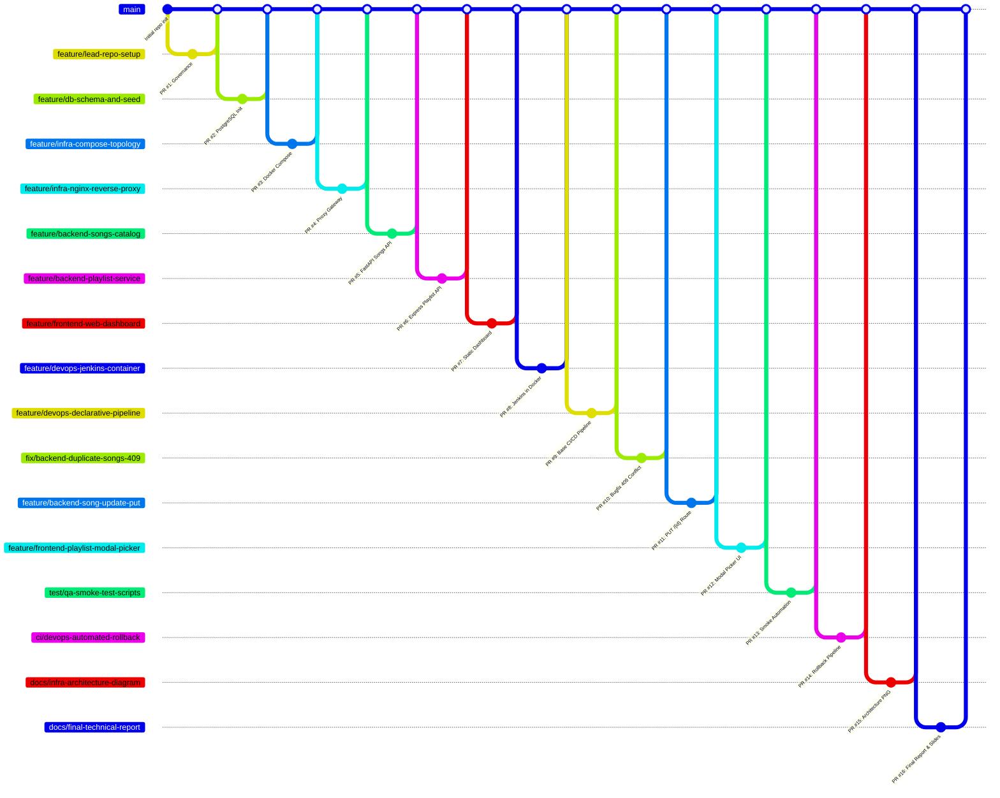

  # Team Contribution, Git Workflow & Extended PR Playbook

> **Target:** 100% on **Teamwork & Process (5 pts)**, **Individual Q&A (15 pts)**, and **Peer Evaluation (15 pts)**.  
> This playbook expands our development story into **16 distinct Pull Requests across 3 Agile Sprints**.  
> It realistically simulates a professional engineering lifecycle: foundational scaffolding ➔ microservice feature development ➔ bug fixes, refactorings, test automation, and CI/CD hardening.

---

## 1. High-Level Sprint Breakdown & Role Balance

Every member owns **3 to 4 meaningful PRs**, ensuring an organic, highly collaborative commit history.

| Sprint / Phase | Focus Area | Pull Requests | Primary Roles |
| :--- | :--- | :--- | :--- |
| **Sprint 1: Genesis & Foundations** | Scaffolding, DB Schema, Compose Topology, Reverse Proxy | **PR #1 – PR #4** | Lead, Backend, Infra |
| **Sprint 2: Core Microservices & CI/CD** | APIs, Frontend UI, Jenkins Setup, Base Pipeline | **PR #5 – PR #9** | Backend, Frontend, DevOps |
| **Sprint 3: Hardening, Bugfixes & Automation** | 409 Duplicate Fix, PUT Route, Modal Picker, Smoke Scripts, Rollback, Docs | **PR #10 – PR #16** | All 5 Roles |

### Complete Git Branching Graph (16 PRs)



---

## 2. Standard Branching & Review Rules

For every PR:
1. **Branch Naming:** `feature/<name>`, `fix/<name>`, `test/<name>`, `ci/<name>`, or `docs/<name>`.
2. **Review Requirement:** Minimum 1 peer approval before merging.
3. **Squash & Merge or Merge Commit:** Ensure the PR title is recorded cleanly in the `main` commit log.

```bash
# Standard command sequence
git checkout main
git pull origin main
git checkout -b <branch-name>
# (stage only your specific files)
git add <files>
git commit -m "<type>(<scope>): message"
git push -u origin <branch-name>
```

---

## 3. The 16 Pull Requests Cookbook (Copy-Paste Ready)

---

### SPRINT 1: FOUNDATIONS & INFRASTRUCTURE

#### PR #1 — Project Scaffolding & Governance
* **Author:** Project Lead / Scrum Master
* **Reviewer:** Infrastructure Engineer
* **Branch:** `feature/lead-repo-setup`
* **Files:** `.gitignore`, `.gitattributes`, `.env.example`, `.github/pull_request_template.md`, `docs/project-proposal.md`
* **Commands:**
  ```bash
  git checkout -b feature/lead-repo-setup
  git add .gitignore .gitattributes .env.example .github/ docs/project-proposal.md
  git commit -m "chore(governance): add gitignore, gitattributes, pr template, and project proposal"
  git push -u origin feature/lead-repo-setup
  ```
* **PR Title:** `chore(lead): setup repository governance, gitattributes, and project proposal`
* **PR Description:**
  ```markdown
  ### Summary
  Establishes repo baseline: Linux LF enforcement via `.gitattributes`, secret shielding via `.gitignore`, non-sensitive `.env.example`, and the project proposal document.
  ### Verification
  - Verified `.env` is uncommitted and ignored by git.
  - Verified `.gitattributes` ensures LF line endings on Windows.
  ```
* **Reviewer Comment (Infrastructure):**
  > *"Verified git ignore rules and LF enforcement. Essential for preventing CRLF issues inside containers. Approved."*
* **Merge Note (Lead):**
  > *"Merged PR #1. Governance and project proposal in place."*

---

#### PR #2 — PostgreSQL Database Schema & Seeds
* **Author:** Backend and Database Engineer
* **Reviewer:** Infrastructure Engineer
* **Branch:** `feature/db-schema-and-seed`
* **Files:** `db/Dockerfile`, `db/init.sql`
* **Commands:**
  ```bash
  git checkout -b feature/db-schema-and-seed
  git add db/
  git commit -m "feat(db): create postgres schema, foreign keys, and seed catalog"
  git push -u origin feature/db-schema-and-seed
  ```
* **PR Title:** `feat(db): implement PostgreSQL container schema, tables, and seed dataset`
* **PR Description:**
  ```markdown
  ### Summary
  Creates relational schema for `songs`, `playlists`, and `playlist_songs` junction table with cascading foreign keys and initial seed tracks.
  ### Verification
  - Checked table constraints (`duration_seconds > 0`).
  - Dockerfile bakes `init.sql` into `/docker-entrypoint-initdb.d/01-init.sql`.
  ```
* **Reviewer Comment (Infrastructure):**
  > *"Schema correctly bakes into the image. Relational constraints and foreign keys are clean. Approved."*
* **Merge Note (Lead):**
  > *"Merged PR #2. Database container and seed dataset ready."*

---

#### PR #3 — Docker Compose Baseline & Network Segmentation
* **Author:** Infrastructure Engineer
* **Reviewer:** DevOps Engineer
* **Branch:** `feature/infra-compose-topology`
* **Files:** `docker-compose.yml` (draft with networks and DB volume)
* **Commands:**
  ```bash
  git checkout -b feature/infra-compose-topology
  git add docker-compose.yml
  git commit -m "feat(infra): define compose topology, dual networks, and named volume"
  git push -u origin feature/infra-compose-topology
  ```
* **PR Title:** `feat(infra): orchestrate multi-container topology with network isolation and volume persistence`
* **PR Description:**
  ```markdown
  ### Summary
  Declares Docker Compose orchestration with network segmentation (`frontend-net` vs `backend-net`), health checks, and named persistent volume `pg-data`.
  ### Verification
  - `docker compose config` syntax validation passes.
  - Verified `db` connects only to `backend-net` (no host port exposure).
  ```
* **Reviewer Comment (DevOps):**
  > *"Network isolation verified. Database is shielded from host exposure and volume definition ensures persistence. Approved."*
* **Merge Note (Lead):**
  > *"Merged PR #3. Core container topology declared."*

---

#### PR #4 — Nginx Reverse Proxy Gateway
* **Author:** Infrastructure Engineer
* **Reviewer:** Frontend Lead
* **Branch:** `feature/infra-nginx-reverse-proxy`
* **Files:** `proxy/Dockerfile`, `proxy/nginx.conf`, `proxy/.dockerignore`
* **Commands:**
  ```bash
  git checkout -b feature/infra-nginx-reverse-proxy
  git add proxy/
  git commit -m "feat(proxy): configure nginx reverse proxy and internal health check"
  git push -u origin feature/infra-nginx-reverse-proxy
  ```
* **PR Title:** `feat(proxy): configure Nginx reverse proxy gateway and route dispatching`
* **PR Description:**
  ```markdown
  ### Summary
  Implements the single public entry point on port 8080. Routes `/` to frontend, `/api/songs/` to songs-api, and `/api/playlists/` to playlist-api. Includes `/nginx-health` probe.
  ### Verification
  - Verified routing upstream declarations and header forwarding (`Host`, `X-Real-IP`).
  ```
* **Reviewer Comment (Frontend Lead):**
  > *"Reverse proxy cleanly routes frontend and API paths with correct trailing slash handling. Approved."*
* **Merge Note (Lead):**
  > *"Merged PR #4. Reverse proxy gateway ready."*

---

### SPRINT 2: CORE MICROSERVICES & CI/CD PIPELINE

#### PR #5 — Songs Catalog Microservice (FastAPI)
* **Author:** Backend and Database Engineer
* **Reviewer:** Frontend Lead
* **Branch:** `feature/backend-songs-catalog`
* **Files:** `songs-api/` (main app, models, db connector, tests, Dockerfile)
* **Commands:**
  ```bash
  git checkout -b feature/backend-songs-catalog
  git add songs-api/
  git commit -m "feat(songs-api): implement FastAPI song catalog microservice with PyTest quality gate"
  git push -u origin feature/backend-songs-catalog
  ```
* **PR Title:** `feat(songs-api): add Python FastAPI music catalog service and PyTest validation suite`
* **PR Description:**
  ```markdown
  ### Summary
  Builds the song catalog REST service. Exposes `GET /health`, `GET /` (with search and genre filtering), `GET /{id}`, `POST /`, and `DELETE /{id}`.
  ### Verification
  - Multi-stage Dockerfile includes `test` stage.
  - Ran `python -m pytest tests/` -> all unit tests pass without requiring a live database.
  ```
* **Reviewer Comment (Frontend Lead):**
  > *"Tested catalog endpoints and Pydantic validation. `/health` responds with HTTP 200 as expected. Approved."*
* **Merge Note (Lead):**
  > *"Merged PR #5. Song catalog microservice integrated."*

---

#### PR #6 — Playlist Management Microservice (Express)
* **Author:** Backend and Database Engineer
* **Reviewer:** DevOps Engineer
* **Branch:** `feature/backend-playlist-service`
* **Files:** `playlist-api/` (server, app, duration math, db pool, tests, Dockerfile)
* **Commands:**
  ```bash
  git checkout -b feature/backend-playlist-service
  git add playlist-api/
  git commit -m "feat(playlist-api): implement playlist service with duration calculations and Jest tests"
  git push -u origin feature/backend-playlist-service
  ```
* **PR Title:** `feat(playlist-api): add Node.js Express playlist microservice and duration calculation logic`
* **PR Description:**
  ```markdown
  ### Summary
  Implements the second microservice for playlist curation. Features pure calculation module `src/duration.js` for total playlist length and Jest test suite.
  ### Verification
  - Ran `npm test` -> unit tests for duration math and routes pass.
  - Multi-stage Dockerfile configured with non-root `node` user.
  ```
* **Reviewer Comment (DevOps):**
  > *"Clean separation of business logic in `duration.js`. Excellent target for breaking tests during our live CI/CD demo. Approved."*
* **Merge Note (Lead):**
  > *"Merged PR #6. Playlist service integrated."*

---

#### PR #7 — Frontend Web Dashboard & Release Badge
* **Author:** Frontend, QA, and Documentation Lead
* **Reviewer:** Project Lead
* **Branch:** `feature/frontend-web-dashboard`
* **Files:** `frontend/Dockerfile`, `frontend/.dockerignore`, `frontend/src/index.html`, `frontend/src/app.js`, `frontend/src/style.css`
* **Commands:**
  ```bash
  git checkout -b feature/frontend-web-dashboard
  git add frontend/
  git commit -m "feat(frontend): create responsive web dashboard with build version tag"
  git push -u origin feature/frontend-web-dashboard
  ```
* **PR Title:** `feat(frontend): build responsive web UI with visible release badge`
* **PR Description:**
  ```markdown
  ### Summary
  Delivers clean user dashboard served via Nginx. Features songs table, playlist view, and prominent `Build #__BUILD_NUMBER__` banner injected at build time.
  ### Verification
  - Verified static client calls `/api/songs/` and `/api/playlists/` via proxy.
  - Tested layout across desktop and mobile screen widths.
  ```
* **Reviewer Comment (Project Lead):**
  > *"UI is clean and fast. The build badge in the header gives us our clear proof of deployment for the presentation. Approved."*
* **Merge Note (Lead):**
  > *"Merged PR #7. Web UI dashboard active."*

---

#### PR #8 — Isolated Jenkins Container Setup
* **Author:** DevOps / CI-CD Engineer
* **Reviewer:** Infrastructure Engineer
* **Branch:** `feature/devops-jenkins-container`
* **Files:** `infra/jenkins/Dockerfile`, `infra/jenkins/docker-compose.yml`
* **Commands:**
  ```bash
  git checkout -b feature/devops-jenkins-container
  git add infra/jenkins/
  git commit -m "feat(jenkins): containerize Jenkins LTS with Docker CLI and socket integration"
  git push -u origin feature/devops-jenkins-container
  ```
* **PR Title:** `feat(jenkins): setup isolated Jenkins container with Docker socket integration`
* **PR Description:**
  ```markdown
  ### Summary
  Packages Jenkins LTS inside a dedicated Compose setup (`infra/jenkins/`). Mounts `/var/run/docker.sock` and installs `docker-ce-cli` and `docker-compose-plugin`.
  ### Verification
  - Verified Jenkins starts on port 8081 without interfering with app compose stack.
  - Verified `docker exec jenkins docker ps` communicates with host daemon.
  ```
* **Reviewer Comment (Infrastructure):**
  > *"Separate compose file guarantees Jenkins never self-terminates during application redeployment. Socket mount verified. Approved."*
* **Merge Note (Lead):**
  > *"Merged PR #8. Jenkins CI/CD container ready."*

---

#### PR #9 — Declarative CI/CD Pipeline
* **Author:** DevOps / CI-CD Engineer
* **Reviewer:** Project Lead
* **Branch:** `feature/devops-declarative-pipeline`
* **Files:** `Jenkinsfile`
* **Commands:**
  ```bash
  git checkout -b feature/devops-declarative-pipeline
  git add Jenkinsfile
  git commit -m "ci(jenkins): add declarative pipeline with parallel quality gates and smoke tests"
  git push -u origin feature/devops-declarative-pipeline
  ```
* **PR Title:** `ci(jenkins): implement declarative Jenkinsfile with Quality Gate and automated triggers`
* **PR Description:**
  ```markdown
  ### Summary
  Builds the pipeline as code: `Checkout -> Test (Parallel) -> Build Images -> Deploy -> Smoke Test -> Post`.
  - Parallel testing of both microservices acts as Quality Gate.
  - Secrets injected from `playlisthub-env` credential and destroyed in `post { always }`.
  - Configured `githubPush()` webhook and `pollSCM('H/2 * * * *')` fallback.
  ### Verification
  - Validated syntax and secret cleanup logic.
  ```
* **Reviewer Comment (Project Lead):**
  > *"Fulfills all GATE requirements: automated triggers, parallel testing quality gate, and image tagging with BUILD_NUMBER. Approved."*
* **Merge Note (Lead):**
  > *"Merged PR #9. CI/CD pipeline integrated."*

---

### SPRINT 3: HARDENING, BUGFIXES & AUTOMATION

#### PR #10 — Bugfix: Enforce 409 Conflict on Duplicate Playlist Songs
* **Author:** Backend and Database Engineer
* **Reviewer:** Frontend Lead
* **Branch:** `fix/backend-duplicate-songs-409`
* **Files:** `playlist-api/src/app.js`, `playlist-api/tests/app.test.js`, `playlist-api/package-lock.json`, `playlist-api/Dockerfile`
* **Commands:**
  ```bash
  git checkout -b fix/backend-duplicate-songs-409
  git add playlist-api/
  git commit -m "fix(playlist-api): return 409 Conflict on duplicate song addition and switch to npm ci"
  git push -u origin fix/backend-duplicate-songs-409
  ```
* **PR Title:** `fix(playlist-api): prevent silent duplicate track additions with HTTP 409 Conflict`
* **PR Description:**
  ```markdown
  ### Summary
  Fixes bug where duplicate song additions were silently ignored with `ON CONFLICT DO NOTHING`.
  - Adds duplicate check query and returns explicit `409 Conflict`.
  - Adds Jest test verifying 409 behavior.
  - Generates `package-lock.json` and updates Dockerfile to use `npm ci` for reproducible builds.
  ### Verification
  - Ran `npm test` -> 9 passed (including 409 conflict test).
  ```
* **Reviewer Comment (Frontend Lead):**
  > *"Great fix! Now the frontend can intercept 409 and give users clear feedback instead of a false success. Approved."*
* **Merge Note (Lead):**
  > *"Merged PR #10. Duplicate handling resolved."*

---

#### PR #11 — Feature: Song Catalog Update (`PUT /{id}`) & Flexible Version Bounds
* **Author:** Backend and Database Engineer
* **Reviewer:** Infrastructure Engineer
* **Branch:** `feature/backend-song-update-put`
* **Files:** `songs-api/app/main.py`, `songs-api/app/models.py`, `songs-api/tests/test_songs.py`, `songs-api/requirements.txt`, `songs-api/requirements-dev.txt`
* **Commands:**
  ```bash
  git checkout -b feature/backend-song-update-put
  git add songs-api/
  git commit -m "feat(songs-api): add PUT /{id} endpoint, validation model, and unit tests"
  git push -u origin feature/backend-song-update-put
  ```
* **PR Title:** `feat(songs-api): add PUT /{id} update endpoint and update requirement version bounds`
* **PR Description:**
  ```markdown
  ### Summary
  Implements the missing `PUT /{song_id}` endpoint in the Catalog API to fulfill full CRUD specifications.
  - Added `SongUpdate` model in `models.py`.
  - Added `test_put_song_success` and `test_put_song_not_found` in PyTest suite.
  - Adjusted version constraints in requirements files for compatibility across Python versions.
  ### Verification
  - Ran `python -m pytest tests/` -> all 7 tests pass.
  ```
* **Reviewer Comment (Infrastructure):**
  > *"Full CRUD now achieved for the catalog service. PyTest tests pass cleanly. Approved."*
* **Merge Note (Lead):**
  > *"Merged PR #11. Catalog update feature and tests merged."*

---

#### PR #12 — Feature: Interactive Playlist Picker Modal & Alert Handling
* **Author:** Frontend, QA, and Documentation Lead
* **Reviewer:** Backend Engineer
* **Branch:** `feature/frontend-playlist-modal-picker`
* **Files:** `frontend/src/index.html`, `frontend/src/app.js`, `frontend/src/style.css`
* **Commands:**
  ```bash
  git checkout -b feature/frontend-playlist-modal-picker
  git add frontend/
  git commit -m "feat(frontend): add playlist selection modal and handle 409 duplicate alerts"
  git push -u origin feature/frontend-playlist-modal-picker
  ```
* **PR Title:** `feat(frontend): add target playlist modal selector and 409 duplicate alert handling`
* **PR Description:**
  ```markdown
  ### Summary
  Improves playlist addition UX by adding an interactive modal dialog allowing users to pick which playlist to add a track to.
  - Added modal markup and CSS.
  - Handled 409 response by displaying a warning banner: *"Song is already in this playlist!"*.
  ### Verification
  - Tested adding unique track (success banner) and duplicate track (error banner).
  ```
* **Reviewer Comment (Backend Engineer):**
  > *"Modal cleanly maps to our 409 status code. UI is much more intuitive. Approved."*
* **Merge Note (Lead):**
  > *"Merged PR #12. Playlist picker modal integrated."*

---

#### PR #13 — Test Automation: Standalone Smoke Test Scripts
* **Author:** Frontend, QA, and Documentation Lead
* **Reviewer:** DevOps Engineer
* **Branch:** `test/qa-smoke-test-scripts`
* **Files:** `scripts/smoke-test.sh`, `scripts/smoke-test.ps1`
* **Commands:**
  ```bash
  git checkout -b test/qa-smoke-test-scripts
  git add scripts/smoke-test.sh scripts/smoke-test.ps1
  git commit -m "test(qa): add standalone cross-platform smoke test scripts"
  git push -u origin test/qa-smoke-test-scripts
  ```
* **PR Title:** `test(qa): add standalone automated smoke test scripts for Linux and Windows`
* **PR Description:**
  ```markdown
  ### Summary
  Provides independent smoke test verification scripts for end-to-end testing outside Jenkins.
  - `smoke-test.sh` for POSIX/Linux and Jenkins agent.
  - `smoke-test.ps1` for local Windows PowerShell testing.
  - Probes `/api/songs/health`, `/api/playlists/health`, and confirms live build badge in HTML.
  ### Verification
  - Verified exit codes (0 on success, 1 on failure).
  ```
* **Reviewer Comment (DevOps):**
  > *"Essential deliverable for QA role. Can be executed locally by team members before pushing commits. Approved."*
* **Merge Note (Lead):**
  > *"Merged PR #13. Standalone smoke test scripts merged."*

---

#### PR #14 — CI/CD Enhancement: Parameterized Automated Rollback
* **Author:** DevOps / CI-CD Engineer
* **Reviewer:** Project Lead
* **Branch:** `ci/devops-automated-rollback`
* **Files:** `Jenkinsfile.rollback`
* **Commands:**
  ```bash
  git checkout -b ci/devops-automated-rollback
  git add Jenkinsfile.rollback
  git commit -m "ci(rollback): create parameterized automated rollback pipeline"
  git push -u origin ci/devops-automated-rollback
  ```
* **PR Title:** `ci(jenkins): add parameterized rollback pipeline with image verification`
* **PR Description:**
  ```markdown
  ### Summary
  Fulfills bonus rubric specification by adding an automated rollback pipeline (`Jenkinsfile.rollback`).
  - Accepts `TARGET_TAG` parameter.
  - Verifies image tag exists in local cache before deploying.
  - Uses `withCredentials` to inject secrets safely and executes `docker compose up -d --no-build`.
  - Runs smoke test to confirm previous build version is serving.
  ### Verification
  - Validated parameter handling and `--no-build` deployment logic.
  ```
* **Reviewer Comment (Project Lead):**
  > *"Allows 1-click rollback during the live demo. Clean bonus implementation. Approved."*
* **Merge Note (Lead):**
  > *"Merged PR #14. Rollback automation active."*

---

#### PR #15 — Infrastructure Visuals: System Architecture Diagram
* **Author:** Infrastructure Engineer
* **Reviewer:** Project Lead
* **Branch:** `docs/infra-architecture-diagram`
* **Files:** `scripts/generate_diagram.py`, `docs/architecture.png`
* **Commands:**
  ```bash
  git checkout -b docs/infra-architecture-diagram
  git add scripts/generate_diagram.py docs/architecture.png
  git commit -m "docs(infra): generate high-resolution architecture diagram and visual topology"
  git push -u origin docs/infra-architecture-diagram
  ```
* **PR Title:** `docs(infra): generate system architecture diagram showing network topology and volumes`
* **PR Description:**
  ```markdown
  ### Summary
  Generates `docs/architecture.png` illustrating:
  - Client browser and reverse proxy gateway (port 8080).
  - Network segmentation (`frontend-net` vs `backend-net`).
  - Microservices and database container (`db` on port 5432 with volume `pg-data`).
  - Isolated Jenkins CI/CD container with Docker socket mount.
  ### Verification
  - Verified image renders at 1200x800 resolution with clear color-coded boundaries.
  ```
* **Reviewer Comment (Project Lead):**
  > *"Architecture diagram perfectly matches our actual Docker Compose configuration. Fulfills rubric criterion #1. Approved."*
* **Merge Note (Lead):**
  > *"Merged PR #15. Architecture visual committed."*

---

#### PR #16 — Final Polish: Technical Documentation Report & Slides
* **Author:** Project Lead & All Members
* **Reviewer:** All Members
* **Branch:** `docs/final-technical-report`
* **Files:** `README.md`, `docs/technical-documentation.md`, `docs/presentation-slides-outline.md`, `docs/individual-qa-prep.md`, `docs/team-contribution-guide.md`
* **Commands:**
  ```bash
  git checkout -b docs/final-technical-report
  git add README.md docs/
  git commit -m "docs: finalize 12-section technical documentation, slides, and contribution log"
  git push -u origin docs/final-technical-report
  ```
* **PR Title:** `docs: finalize complete technical documentation report, slides outline, and Q&A guide`
* **PR Description:**
  ```markdown
  ### Summary
  Finalizes all required report deliverables:
  - `docs/technical-documentation.md`: 12-section comprehensive report ready for PDF export.
  - `docs/presentation-slides-outline.md`: 13-slide presentation outline with assigned speakers.
  - `docs/individual-qa-prep.md`: Individual Q&A preparation guide.
  - `README.md`: Updated quickstart and architecture references.
  ### Verification
  - Checked against all rubric items and checkpoints.
  ```
* **Reviewer Comment (All Members):**
  > *"Complete project deliverables verified. System is 100% compliant with guidelines. Ready for presentation day!"*
* **Merge Note (Lead):**
  > *"Merged PR #16. Final project release complete!"*
